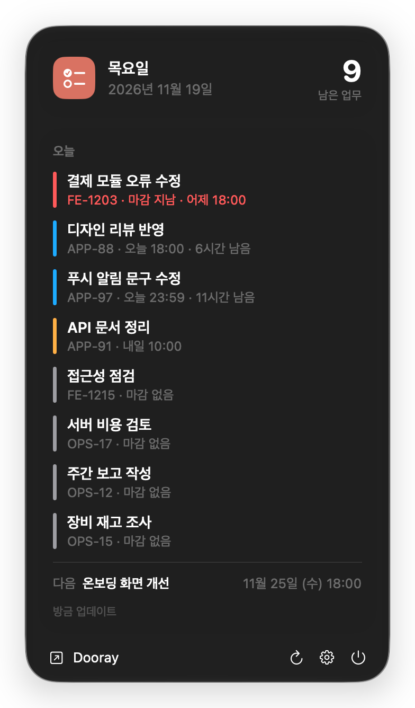
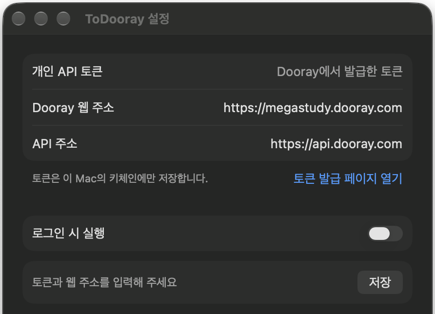
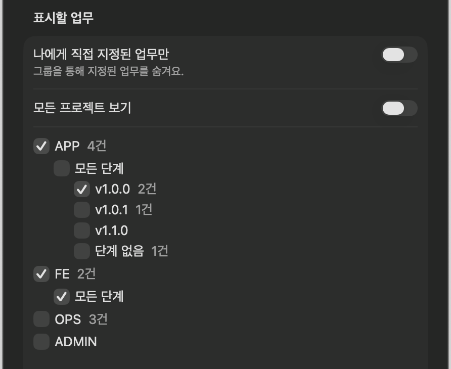

# ToDooray

ToDooray는 Dooray에서 내가 처리할 업무를 macOS 메뉴바에 보여주는 앱입니다. 메뉴바에는 오늘 마감이 가장 가까운 업무나 남은 업무 수가 한 줄로 나오고, 누르면 업무 목록이 열립니다.

macOS 14 이상에서 동작합니다. 화면의 업무는 예시 데이터입니다.

## 설치하기

1. [Releases](https://github.com/megastudymobile/ToDooray/releases)에서 최신 `ToDooray-<버전>.zip`을 내려받습니다.
2. zip을 풀고 `ToDooray.app`을 응용 프로그램 폴더로 옮깁니다.
3. `ToDooray.app`을 엽니다. 처음 실행하면 설정 창이 열립니다.

## Dooray에 연결하기

1. 설정 창에서 **토큰 발급 페이지 열기**를 누릅니다. Dooray의 API 토큰 페이지가 열립니다.
2. 토큰을 새로 만들고 값을 복사합니다.
3. **개인 API 토큰** 칸에 붙여 넣고 **저장**을 누릅니다.

**Dooray 웹 주소**는 `https://megastudy.dooray.com`으로 미리 채워져 있습니다. 토큰은 이 Mac의 키체인에만 저장됩니다.

저장 후 설정 창 아래에 "연결됨 · 업무 n건"이 나오면 연결된 것입니다.

## 패널 보기

메뉴바의 ToDooray 항목을 누르면 패널이 열립니다. 내가 담당자이고 내 담당 상태가 "할 일"이나 "진행 중"인 업무만 나옵니다.

- **오늘** 목록은 업무 왼쪽 막대 색으로 마감을 나타냅니다. 빨간색은 마감 지남, 파란색은 오늘 마감, 회색은 마감 없음입니다.
- 내일 이후가 마감인 업무는 **다음** 줄에 가장 이른 것 하나와 나머지 건수로 나옵니다.
- 업무를 누르면 Dooray에서 그 업무가 열립니다.
- 목록은 5분마다 새로 고칩니다. 바로 새로 고치려면 아래 줄의 ↻를 누르거나 `⌘R`을 누릅니다.
- 아래 줄의 **Dooray**는 Dooray 웹을 열고, 톱니바퀴는 설정 창을 엽니다.

## 보고 싶은 업무만 고르기

설정 창의 **표시할 업무**에서 고릅니다. 바꾸면 바로 적용됩니다.

- 그룹으로만 지정된 업무를 숨기려면 **나에게 직접 지정된 업무만**을 켭니다.
- 프로젝트를 고르려면 **모든 프로젝트 보기**를 끄고, 볼 프로젝트에 체크합니다. 업무가 아직 없는 프로젝트도 목록에 나옵니다.
- 프로젝트 안에서 단계를 고르려면 그 프로젝트의 **모든 단계**를 끄고, 볼 단계에 체크합니다. 단계가 없는 업무는 **단계 없음**으로 고릅니다.

숨긴 업무가 있으면 패널 아래에 "필터 적용 중 · 숨긴 업무 n건"이 나옵니다.

로그인할 때 자동으로 켜려면 설정 창에서 **로그인 시 실행**을 켭니다.

## 메뉴바에 항목이 보이지 않을 때

메뉴바가 가득 차거나 메뉴바 정리 앱을 쓰면 macOS가 ToDooray 항목을 숨깁니다. 이때는 Finder, Spotlight, Launchpad에서 ToDooray를 다시 실행합니다. 이미 실행 중이면 패널이 열립니다.

## 업데이트하기

새 버전의 zip을 내려받아 응용 프로그램 폴더의 `ToDooray.app`을 바꿔 넣습니다. 토큰과 설정은 그대로 남습니다.

## 개발

빌드와 테스트, 배포 방법은 [docs/development.md](docs/development.md)에 있습니다. Dooray API 사용 규칙은 [docs/dooray-api.md](docs/dooray-api.md)에 있습니다. README의 화면은 `fixtures/scenarios/basic`의 예시 데이터로 찍었습니다.
